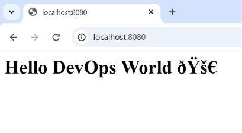

# DevOps Basic Project 🚀

## Description
Project ini merupakan simulasi deployment aplikasi sederhana menggunakan Docker dan Docker Compose.

## Features
- Dockerized NGINX application
- Automation deployment menggunakan Bash
- Expose service ke localhost

## Tech Stack
- Docker
- Docker Compose
- Nginx
- Bash

## Architecture
Simple containerized web application deployed using Docker.

User → Browser → Nginx Container → Web Content

## Screenshot



## Reverse Proxy Containeronfiguration

NGINX digunakan sebagai Reverse Proxy untuk meneruskan request dari port 80 ke aplikasi Docker yang berjalan pada port 8080.

User
↓
NGINX Reverse Proxy (Port 80)
↓
Docker Container (Port 8080)
↓
Web Application

## Technologies

- Docker
- Docker Compose
- NGINX
- Bash
- Linux
- Git
## How to Run
```bash
chmod +x deploy.sh
./deploy.sh
